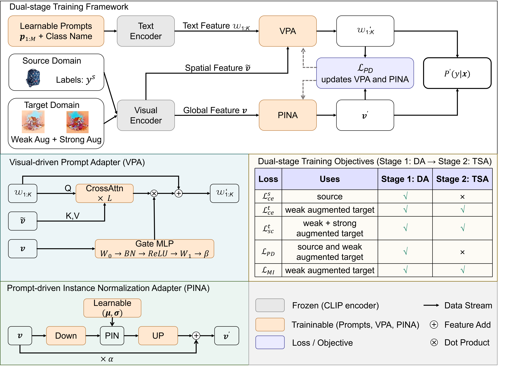

# Cross-Modal Interaction and Target-Specific Adaptation for Unsupervised Domain Adaptation

Official implementation of *Cross-Modal Interaction and Target-Specific Adaptation for Unsupervised Domain Adaptation*.

The method has two parts: a pair of reciprocal adapters — the Visual-driven Prompt Adapter (VPA) and the Prompt-driven Instance Normalisation Adapter (PINA) — and a two-stage training schedule, in which a domain adaptation (DA) stage on source and target data is followed by a target-specific adaptation (TSA) stage on target data only.

---
<div align="center">
  
</div>

---

## Contents

| Path | Description |
|---|---|
| `train.py` | Training entry point (built on Dassl) |
| `trainer/Model.py` | Model, adapters, losses and the two training stages |
| `trainer/clip/` | CLIP backbone |
| `configs/datasets/` | Dataset and backbone configuration |
| `configs/trainers/MODEL/` | Training configuration (`model.yaml`: DA + TSA; `test.yaml`: TSA only) |
| `scripts/` | Run scripts for the three benchmarks, plus a generic launcher (`run.sh`) |
| `logs/` | Sample training logs for two tasks |

## Installation

The code is built with PyTorch 2.11.0 (CUDA 13.2) and tested on Linux with an NVIDIA RTX 5880 Ada Generation.

```bash
conda create -n uda python=3.12
conda activate uda
```

The code builds on CLIP and Dassl, which can be installed with:

```bash
# install CLIP
pip install git+https://github.com/openai/CLIP.git

# install Dassl
git clone https://github.com/KaiyangZhou/Dassl.pytorch.git
cd Dassl.pytorch
pip install -r requirements.txt
pip install .
cd ..
```

Other dependencies can be installed with:

```bash
pip install -r requirements.txt
```

## Datasets

The benchmarks can be downloaded from:

- VisDA-2017 — <http://ai.bu.edu/visda-2017/#download>
- Office-Home — <https://drive.google.com/file/d/0B81rNlvomiwed0V1YUxQdC1uOTg/view>
- Mini-DomainNet — <http://ai.bu.edu/DomainNet/>

The scripts read two environment variables, so neither the dataset path nor the GPU index is hard-coded:

```bash
export DATA=/path/to/dataset   # root directory that holds the datasets
export GPU=0                   # index of the GPU to use
```

If they are left unset, the scripts fall back to `/path/to/dataset` and GPU 0. The dataset layout follows the one used by [DAPrompt](https://github.com/LeapLabTHU/DAPrompt) and [DAMP](https://github.com/TL-UESTC/DAMP).

### Directory layout

`--root` (the `DATA` variable) must point to a directory containing the three datasets, each with one folder per domain, and each domain folder holding one sub-folder per class:

```text
/path/to/dataset
├── office_home
│   ├── art
│   ├── clipart
│   ├── product
│   └── real_world
├── visda17
│   ├── train
│   ├── validation
│   ├── test
│   └── splits
└── domainnet
    ├── clipart
    ├── painting
    ├── real
    ├── sketch
    └── splits_mini
```

`splits_mini` is the folder provided in this repository; the rest comes from the official distributions.

### Splits

For **Office-Home** and **VisDA-2017** nothing needs to be done: place them exactly as distributed. Office-Home consists of four domain folders, each holding one sub-folder per class, and has no train/validation split. VisDA-2017 ships as a synthetic and a real domain, which the loader maps to the corresponding train and validation folders at run time. Neither dataset is re-split by this code.

**Mini-DomainNet** is the exception: the four-domain subset does not come with a split, so one is provided in `splits_mini/` at the root of this repository — one train/test pair per domain (`clipart_train.txt`, `clipart_test.txt`, `painting_*`, `real_*`, `sketch_*`). Copy the whole folder into the downloaded DomainNet directory, at the same level as the image folders, so that the loader finds it.

The Mini-DomainNet split files follow the split released with the subset in Zhou et al., *Domain Adaptive Ensemble Learning*, IEEE Transactions on Image Processing, 2021 — the work that introduced the four-domain subset and released the [Dassl](https://github.com/KaiyangZhou/Dassl.pytorch) platform this code builds on.

## Reproducing the main results

The scripts must be run from inside `scripts/`, because each of them starts with `cd ..`.

```bash
cd scripts

# Office-Home: 12 tasks x 3 seeds, ResNet-50
DATA=/path/to/dataset GPU=0 bash office_home.sh

# VisDA-2017: synthetic -> real, 3 seeds, ResNet-101
DATA=/path/to/dataset GPU=0 bash VisDa17.sh

# Mini-DomainNet: 12 tasks x 3 seeds, ResNet-50
DATA=/path/to/dataset GPU=0 bash miniDomainNet.sh
```

Both variables can also be exported once; the commands above show them inline only for clarity.

| Paper table | Script | Backbone | Longest task | Runtime | Peak GPU memory |
|---|---|---|---|---|---|
| Office-Home, ResNet-50 | `office_home.sh` | RN50 | product → real_world | ≈ 1.5 h | ≈ 9 GB |
| VisDA-2017, ResNet-101 | `VisDa17.sh` | RN101 | synthetic → real | ≈ 2.5 h | ≈ 11 GB |
| Mini-DomainNet, ResNet-50 | `miniDomainNet.sh` | RN50 | sketch → real | ≈ 2.9 h | ≈ 11 GB |

The figures are for the task with the longest runtime in each benchmark, measured on one RTX 5880 Ada Generation with a batch size of 32; the remaining tasks of the same benchmark take less.

Every run writes its training log and the resolved configuration to the output directory. Two complete logs are kept in `logs/` for readers who want to see the per-epoch behaviour and the actual timing without re-running the code: `office_home_rn50_pr2rw_seed1.txt` and `visda17_rn101_seed1.txt`. Paths in those files have been replaced by `/path/to/dataset`.

**Backbone.** The visual encoder is set in `configs/datasets/*.yaml` via `MODEL.BACKBONE.NAME`, which accepts `RN50`, `RN101` and `ViT-B/16`. The scripts above use the backbones of the corresponding table; to reproduce the other column of the paper, change this value (and the `VB` variable in the script, which only affects the output directory name). CLIP pre-trained weights are looked up in the directory given by `MODEL.BACKBONE.PATH`.

## Running a single task with custom settings

The three scripts above run fixed task lists. For anything else — a different domain pair, a different backbone, a single seed — use `scripts/run.sh`. It runs one dataset, one domain pair and any set of seeds, and leaves every choice to the caller.

Fill in the block at the top of the file:

```bash
DATASET=office_home    # office_home | visda17 | minidomainnet
SRC=art                # source domain
TGT=clipart            # target domain
BACKBONE=ViT-B/16      # RN50 | RN101 | ViT-B/16 ; empty = use the value in configs/datasets/*.yaml
SEEDS="1 2 3"
```

then run it from `scripts/`:

```bash
DATA=/path/to/dataset GPU=0 bash run.sh
```

Nothing is hard-coded: every field can also be passed inline, e.g.

```bash
DATASET=visda17 SRC=synthetic TGT=real BACKBONE=RN101 SEEDS="4 5" bash run.sh
```

The hyperparameters are declared in the same file with the values used in the paper (`TAU=0.5`, `PIN=0.5`, `ENT=1.0`, `T=1.0`, `U=1.0`), and the adapter switches (`TEXT`, `VIS`) are exposed in the same way. If `DATASET`, `SRC` or `TGT` is left empty, the script prints a usage message and stops.

## Hyperparameters

The same configuration is used for every dataset and both backbones.

| Meaning | Flag | Value |
|---|---|---|
| Confidence threshold γ | `TRAINER.MODEL.TAU` | 0.5 |
| Weight of the prompt-guided loss λ_p | `TRAINER.MODEL.PIN` | 0.5 |
| Weight of the mutual-information loss λ_m | `TRAINER.MODEL.ENT` | 1.0 |
| Learnable prompt length M | `TRAINER.MODEL.N_CTX` | 32 |
| Batch size | `DATALOADER.TRAIN_X.BATCH_SIZE` | 32 |
| DA epochs | `OPTIM.MAX_EPOCH` | 30 |
| TSA epochs | `OPTIM_V.MAX_EPOCH` | 10 |
| Learning rate (DA / TSA) | `OPTIM.LR` / `OPTIM_V.LR` | 3e-3 / 1e-3, cosine |

All reported numbers are the mean and standard deviation over seeds 1, 2 and 3; the scripts iterate over these seeds, and `SEEDS` in `run.sh` selects them explicitly.

## Ablation settings

Each row of the ablation tables corresponds to the flags below; every other setting is identical to the full model.

| Setting | Flags |
|---|---|
| Full model | defaults of `configs/trainers/MODEL/model.yaml` |
| w/o VPA | `TRAINER.MODEL.TEXT False` |
| w/o PINA | `TRAINER.MODEL.VISUAL False` |
| w/o TSA (DA only) | `OPTIM_V.MAX_EPOCH 0` |
| w/o DA (TSA only) | `OPTIM.MAX_EPOCH 0` — see `configs/trainers/MODEL/test.yaml` |
| L_PD weighting | `TRAINER.MODEL.PD_MODE` — `uniform` (default), `pl`, `topk`, `prob`; `TRAINER.MODEL.PD_TOPK` sets k for `topk` (default 5) |

Pass them after the script arguments, in the same way as the existing overrides:

```bash
python train.py ... TRAINER.MODEL.TEXT False
```

## Troubleshooting

- **Wrong GPU.** The scripts run on the GPU given by `GPU` (default `0`); pass `GPU=<index>` or export it before running.
- **Dataset not found.** If the loader raises an error about a missing domain, check that `DATA` points to the directory holding the datasets and that the folder names match the ones in `configs/datasets/*.yaml`.
- **Out of memory.** The reported results use a batch size of 32; reducing `DATALOADER.TRAIN_X.BATCH_SIZE` will change the results and is not recommended for reproduction.
- **Dassl version.** The code expects the Dassl version pinned in `requirements.txt`; a newer release may change the configuration keys used in `configs/`.

## Citation

If you find the code useful, please consider citing:

```bibtex
@InProceedings{cmista,
  title  = {Cross-Modal Interaction and Target-Specific Adaptation for Unsupervised Domain Adaptation},
  author = {Zihong Zheng, Min Meng and Jigang Wu},
  year   = {2026}
}
```

## Acknowledgements

This project builds on the contributions of the following open-source projects:

1. [DAPrompt](https://github.com/LeapLabTHU/DAPrompt)
2. [CoOp](https://github.com/KaiyangZhou/CoOp)
3. [DAMP](https://github.com/TL-UESTC/DAMP)

We thank the authors for sharing their code.
